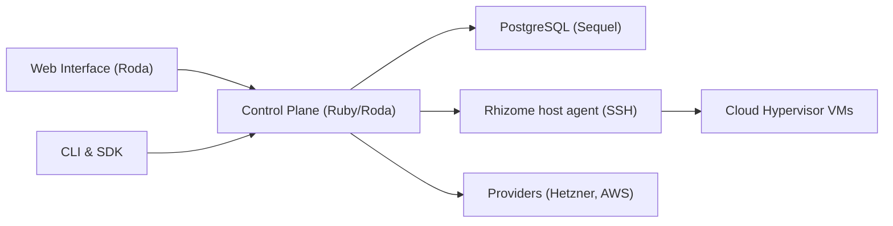

# ubicloud/ubicloud

> Cloud IaaS open source qui tourne sur machines nues (Hetzner, AWS Bare Metal), en auto-hébergé ou géré.

## Le problème
Les grands clouds coûtent cher et enferment ; construire son propre cloud sur du bare metal est complexe.

## Ce que ça fait vraiment
Un plan de contrôle Ruby (Roda, Sequel, Rodauth) garde l'état voulu dans PostgreSQL. Des machines à états (« progs ») exécutent des commandes en SSH sur les hôtes. Services : VM Cloud Hypervisor, Postgres managé, Kubernetes, runners GitHub Actions, inférence IA, réseau (IPsec, nftables). Le stockage de blocs vient d'ubiblk.

## Comment c'est branché


## Essayer
```bash
git clone git@github.com:ubicloud/ubicloud.git
./demo/generate_env
docker-compose -f demo/docker-compose.yml up
docker exec -it ubicloud-app ./demo/cloudify_server
```

## Coût et pièges
Le service géré est payant ; l'auto-hébergement demande des machines louées (Hetzner) et les identifiants du fournisseur dans `.env`. IPv6 requis ou tunnel.

## Ce que ce n'est pas
Pas un clone complet d'AWS : le projet vise 10 % des services pour 80 % de la consommation. Auto-hébergement : le script de « cloudification » ne gère que Hetzner.

## Alternatives
- OpenStack : plus généraliste, mais plus lourd à exploiter selon le README.

## Pour toi
À surveiller : intéressant pour des runners CI ou du GPU/inférence moins chers ; AGPL à lire si tu le modifies pour offrir un service.

