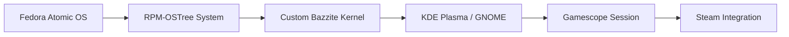

# ublue-os/bazzite

> Image Fedora Atomic orientée jeu vidéo, pour PC, console portable et Steam Deck.

## Le problème
SteamOS a des paquets anciens et pas de vrai gestionnaire de paquets ; on veut une base atomique à jour pour jouer.

## Ce que ça fait vraiment
Image système construite sur ublue-os/main : noyau OGC, HDR/VRR, pilotes (xone, DisplayLink, OpenRazer), Distrobox, Waydroid, mises à jour du système et des Flatpaks, retour arrière via rpm-ostree. Variantes bureau, Steam Deck/HTPC, KDE ou GNOME, avec ou sans NVIDIA. Images signées avec cosign.

## Comment c'est branché


## Essayer
```bash
rpm-ostree rebase ostree-unverified-registry:ghcr.io/ublue-os/bazzite:stable
```
Variante NVIDIA : image `bazzite-nvidia`. Le README renvoie aussi aux ISOs du site.

## Coût et pièges
Gratuit. Secure Boot : clé à enrôler, mot de passe `universalblue`. Ne pas activer Secure Boot sur un Steam Deck sans savoir. Le reboot sur une image distincte reste à gérer.

## Ce que ce n'est pas
Pas une distribution orientée serveur ni MLOps : tout est tourné vers le jeu.

## Alternatives
Aucune alternative nommée dans le README (SteamOS est évoqué comme point de comparaison).

## Pour toi
Ignorer : pensée pour le jeu ; pour du GPU de calcul, une base serveur plus sobre convient mieux.

