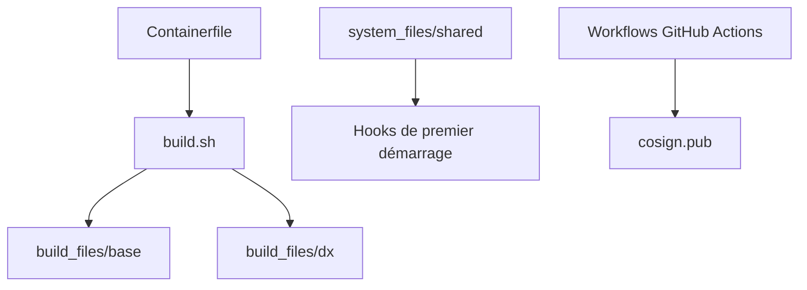

# ublue-os/bluefin

> Immutable Fedora-based Linux desktop system with built-in container tooling for developers.

## The problem
Maintaining a reliable, up-to-date, container-ready Linux workstation requires manual configuration.

## What it actually does
An atomic operating system image built by a Containerfile and GitHub Actions workflows, in two variants: base and "dx" for developers (Docker, Incus, libvirt, VFIO, preconfigured VS Code). First-boot hooks handle theme, Tailscale, Flatpak and Framework hardware. Images are signed with cosign.

## How it is wired


## Trying it
```bash
ujust enroll-secure-boot-key
```
Installation is described on projectbluefin.io.

## Cost and gotchas
Free. You have to install a full system; Secure Boot requires enrolling a key, with the password `universalblue` given in the README.

## What it is not
Not a package to add to an existing system: it is an entire system. Not GPU- or ML-oriented in itself, nothing is documented on this.

## Alternatives
No alternative named in the README.

## For you
Watch: interesting for a stable containerized dev workstation, but only worth adopting if you want to change operating system.
