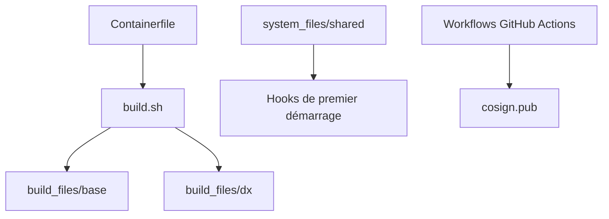

# ublue-os/bluefin

> Système de bureau Linux immuable basé sur Fedora, avec outils de conteneurs intégrés pour développeurs.

## Le problème
Maintenir un poste Linux fiable, à jour et prêt pour les conteneurs demande de la configuration manuelle.

## Ce que ça fait vraiment
Image de système d'exploitation atomique construite par un Containerfile et des workflows GitHub Actions, en deux variantes : base et « dx » pour développeurs (Docker, Incus, libvirt, VFIO, VS Code préconfiguré). Des hooks de premier démarrage gèrent thème, Tailscale, Flatpak et matériel Framework. Images signées par cosign.

## Comment c'est branché


## Essayer
```bash
ujust enroll-secure-boot-key
```
L'installation est décrite sur projectbluefin.io.

## Coût et pièges
Gratuit. Il faut installer un système complet ; Secure Boot demande d'enrôler une clé, mot de passe `universalblue` indiqué dans le README.

## Ce que ce n'est pas
Pas un paquet à ajouter à un système existant : c'est un système entier. Pas orienté GPU ou ML en soi, rien n'est documenté à ce sujet.

## Alternatives
Aucune alternative nommée dans le README.

## Pour toi
Surveiller : intéressant pour un poste de dev conteneurisé stable, mais à adopter seulement si tu veux changer de système.

