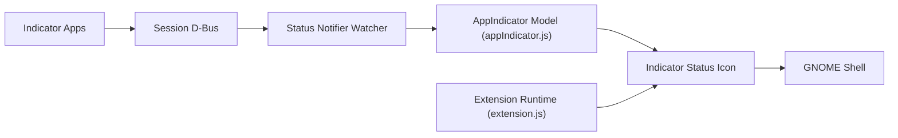

# ubuntu/gnome-shell-extension-appindicator

> GNOME Shell extension that displays system tray icons (AppIndicator) in the panel.

## The problem
GNOME removed the system tray; many applications (Electron in particular) depend on it for their menu.

## What it actually does
Discovers AppIndicators and KStatusNotifierItems on the session D-Bus, models their properties and menus, and places them in the panel. Click for the menu, double click to activate the window, middle click for secondary activation. Also handles legacy status bar icons (X11). Tooltips are deliberately not implemented.

## How it is wired


## Trying it
```bash
git clone https://github.com/ubuntu/gnome-shell-extension-appindicator.git
meson gnome-shell-extension-appindicator /tmp/g-s-appindicators-build
ninja -C /tmp/g-s-appindicators-build install
gnome-extensions enable appindicatorsupport@rgcjonas.gmail.com
```

## Cost and gotchas
Free; recommended via extensions.gnome.org. `libappindicator` must be present on the application side. On Wayland, you must log back in after installation.

## What it is not
Not a notification manager. Bugs without reproduction steps are closed.

## Alternatives
No alternative named in the README.

## For you
Ignore: Linux desktop tweak, unrelated to data or AI, unless you personally need it for GNOME.
