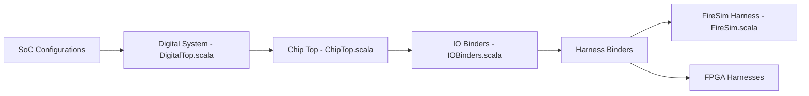

# ucb-bar/chipyard

> Framework de Berkeley pour générer des SoC RISC-V en Chisel, simuler, passer en FPGA et en VLSI.

## Le problème
Concevoir un système sur puce demande d'assembler cœurs, accélérateurs, périphériques et flux de simulation et d'implémentation dispersés.

## Ce que ça fait vraiment
Fournit cœurs (Rocket, BOOM, CVA6), unités vectorielles (Saturn, Ara), accélérateurs (Gemmini, NVDLA) et mémoires, puis les relie à des flux : simulation RTL, simulation FPGA (FireSim), VLSI (Hammer) et charges de travail (FireMarshal). D'après le code : une configuration produit un système, dont ports et horloges sont liés à un banc de test ou à une carte FPGA.

## Comment c'est branché

## Essayer
Aucune commande dans le README : tout passe par la doc https://chipyard.readthedocs.io/. Non documenté ici.

## Coût et pièges
Gratuit, mais la chaîne d'outils (Chisel, FireSim, FPGA, VLSI) est lourde ; ces prérequis sont détaillés seulement dans la doc externe.

## Ce que ce n'est pas
Pas un outil IA/data. C'est du matériel : la citation académique (IEEE Micro 2020) est demandée en cas d'usage en recherche.

## Alternatives
Aucune nommée dans le README.

## Pour toi
Ignorer : conception de puces RISC-V, hors périmètre data/IA/MLOps, sauf si tu travailles sur des accélérateurs matériels.

