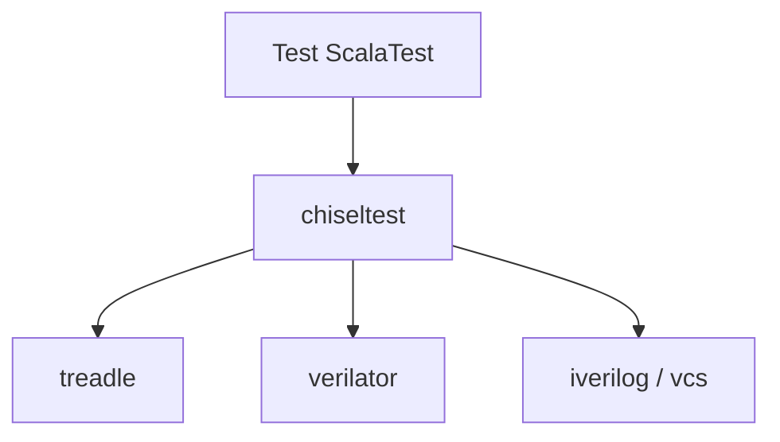

# ucb-bar/chiseltest

> Testing and formal verification library for hardware circuits written in Chisel.

## The problem
Testing Chisel RTL designs takes a lot of boilerplate code and hard-to-read testbenches.

## What it actually does
Integrates with ScalaTest: `poke`, `step`, `expect` on the module under test, `fork`/`join` threads for testbenches. Simulators: treadle (default), verilator, iverilog, vcs. Compatibility layer with PeekPokeTester.

## How it is wired
Simplified diagram based on the sheet, no diagram provided.


## Trying it
```bash
sbt test
sbt
> testOnly <spec name> -- -oF
```

## Cost and gotchas
Free. Requires sbt, a JDK, and verilator depending on the backend (outside the prerequisites list). Archived: the team stopped for lack of a maintainer.

## What it is not
Not a general software testing tool: reserved for Chisel hardware. No longer maintained.

## Alternatives
No alternative named in the README.

## For you
Ignore: hardware design is out of scope and the project is archived, unless you take over a fork for Chisel.
