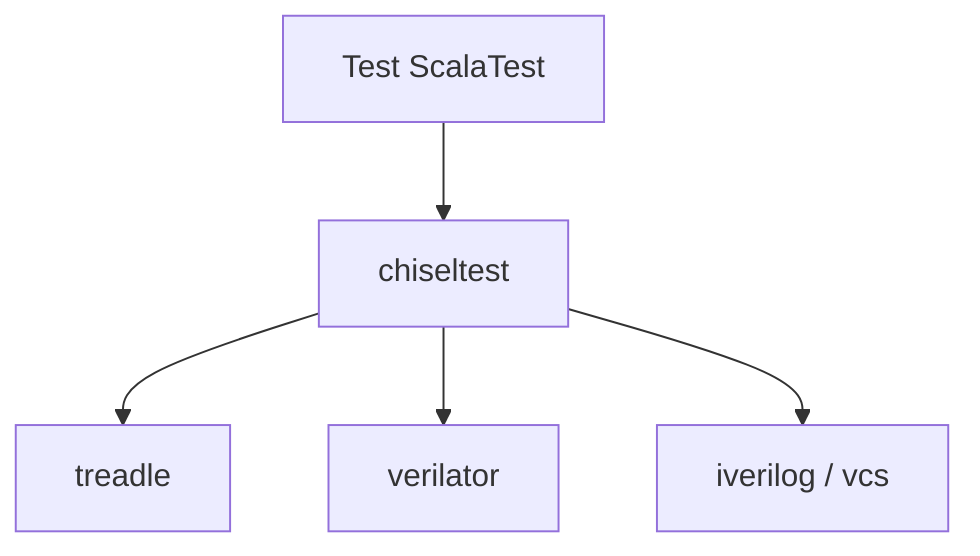

# ucb-bar/chiseltest

> Bibliothèque de test et de vérification formelle pour circuits matériels écrits en Chisel.

## Le problème
Tester des conceptions RTL Chisel demande beaucoup de code répétitif et des testbenches peu lisibles.

## Ce que ça fait vraiment
S'intègre à ScalaTest : `poke`, `step`, `expect` sur le module testé, threads `fork`/`join` pour les testbenches. Simulateurs : treadle (défaut), verilator, iverilog, vcs. Couche de compatibilité avec PeekPokeTester.

## Comment c'est branché
Schéma simplifié d'après la fiche, sans diagramme fourni.


## Essayer
```bash
sbt test
sbt
> testOnly <spec name> -- -oF
```

## Coût et pièges
Gratuit. Il faut sbt, un JDK, et verilator selon le backend (hors liste des prérequis). Archivé : l'équipe a arrêté faute de mainteneur.

## Ce que ce n'est pas
Pas un outil de test logiciel général : réservé au matériel Chisel. Plus maintenu.

## Alternatives
Aucune alternative nommée dans le README.

## Pour toi
À ignorer : conception matérielle hors périmètre et projet archivé, sauf si tu reprends un fork pour du Chisel.

