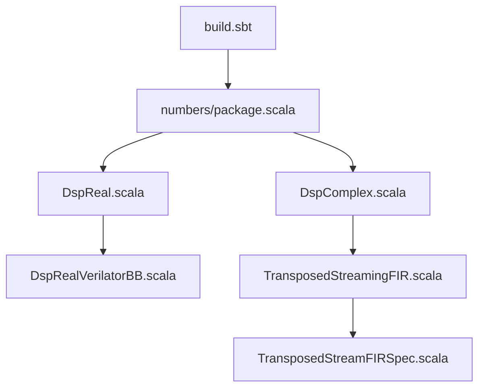

# ucb-bar/dsptools

> Chisel library for designing signal-processing generators with generic numeric types.

## The problem
Designing a hardware digital filter forces you to redo the circuit to go from floating point to fixed point, and to test pipeline delays.

## What it actually does
Numeric type classes (real, complex, fixed point) through which the same Chisel module is generated first in floating point then in fixed point. Adds pipeline delay control, a testbench with tolerances, lookup table modules, memories and an FIR filter example.

## How it is wired


## Trying it
```scala
libraryDependencies += "edu.berkeley.cs" %% "dsptools" % "XXXX"
```

## Cost and gotchas
Free. It needs Scala, sbt and Chisel: Scala is not in the list of prerequisites. Last push in April 2024, more than a year ago.

## What it is not
Not a software signal-processing library: it generates hardware. The rocket-chip tools were moved to another repo.

## Alternatives
Rocket Dsp Utils: repo cited for integration with rocket-chip.

## For you
Ignore: circuit design, and the repo has not moved since 2024.
