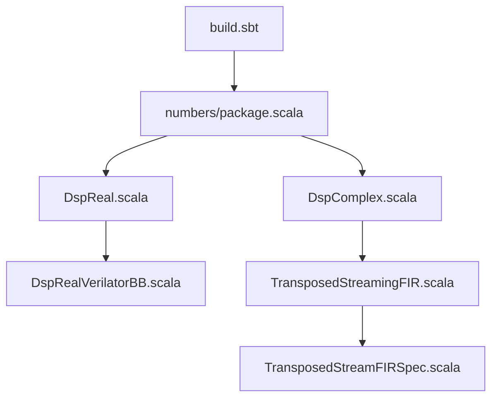

# ucb-bar/dsptools

> Bibliothèque Chisel pour concevoir des générateurs de traitement du signal avec types numériques génériques.

## Le problème
Concevoir un filtre numérique matériel oblige à refaire le circuit pour passer du flottant à la virgule fixe, et à tester les retards de pipeline.

## Ce que ça fait vraiment
Classes de types numériques (réel, complexe, virgule fixe) par lesquelles un même module Chisel se génère en flottant puis en virgule fixe. Ajoute contrôle des retards de pipeline, banc de test avec tolérances, modules de tables de consultation, mémoires et un exemple de filtre FIR.

## Comment c'est branché


## Essayer
```scala
libraryDependencies += "edu.berkeley.cs" %% "dsptools" % "XXXX"
```

## Coût et pièges
Gratuit. Il faut Scala, sbt et Chisel : Scala n'existe pas dans la liste des prérequis. Dernier push en avril 2024, soit plus d'un an.

## Ce que ce n'est pas
Pas une bibliothèque de traitement du signal logicielle : elle génère du matériel. Les outils rocket-chip ont été déplacés dans un autre dépôt.

## Alternatives
Rocket Dsp Utils : dépôt cité pour l'intégration avec rocket-chip.

## Pour toi
À ignorer : de la conception de circuits, et le dépôt n'a pas bougé depuis 2024.

