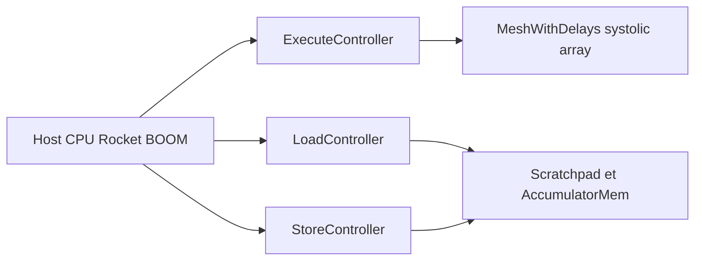

# ucb-bar/gemmini

> Chisel generator of a RISC-V matrix accelerator for exploring and evaluating neural network hardware.

## The problem
Understanding how hardware and the software stack interact on DNN performance requires a full exploration platform, not just an isolated accelerator.

## What it actually does
Generates a RoCC accelerator with a systolic array, scratchpad, accumulator, DMA and ROB, configurable (dimensions, dataflow, types). Provides a custom ISA (`mvin`, `mvout`, `matmul.preload`, CISC loop instructions), a C library, tests (ResNet50) and an ONNX-Runtime port. Simulation with Spike, Verilator or FireSim. Part of Chipyard.

## How it is wired


## Trying it
```bash
git clone https://github.com/ucb-bar/chipyard.git
cd chipyard
./build-setup.sh
source env.sh
cd generators/gemmini
make -C software/libgemmini install
cd chipyard/sims/verilator
make CONFIG=GemminiRocketConfig
```

## Cost and gotchas
Free but heavy: requires installing Chipyard and the RISC-V toolchain. Full DNNs are too slow on Verilator; the README recommends FireSim (FPGA). A license is present but not identified by GitHub.

## What it is not
Not a tool for training or serving a model. Some features (pooling, normalization, CISC loops) are marked experimental.

## Alternatives
No alternative named in the README (Chipyard, FireSim and Spike are dependencies, not substitutes).

## For you
Worth watching: interesting for understanding the architecture of a DNN accelerator, useless for everyday MLOps use.
