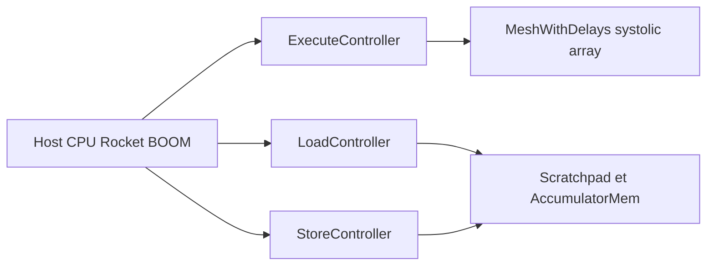

# ucb-bar/gemmini

> Générateur Chisel d'accélérateur matriciel RISC-V pour explorer et évaluer du matériel de réseaux de neurones.

## Le problème
Comprendre comment le matériel et la pile logicielle interagissent sur la performance DNN demande une plateforme d'exploration complète, pas seulement un accélérateur isolé.

## Ce que ça fait vraiment
Génère un accélérateur RoCC avec réseau systolique, scratchpad, accumulateur, DMA et ROB, paramétrable (dimensions, flux de données, types). Fournit un ISA personnalisé (`mvin`, `mvout`, `matmul.preload`, instructions CISC de boucle), une bibliothèque C, des tests (ResNet50) et un port d'ONNX-Runtime. Simulation avec Spike, Verilator ou FireSim. Fait partie de Chipyard.

## Comment c'est branché


## Essayer
```bash
git clone https://github.com/ucb-bar/chipyard.git
cd chipyard
./build-setup.sh
source env.sh
cd generators/gemmini
make -C software/libgemmini install
cd chipyard/sims/verilator
make CONFIG=GemminiRocketConfig
```

## Coût et pièges
Gratuit mais lourd : installation de Chipyard et de la chaîne RISC-V. Les DNN complets sont trop lents sur Verilator ; le README recommande FireSim (FPGA). Licence présente mais non identifiée par GitHub.

## Ce que ce n'est pas
Pas un outil pour entraîner ou servir un modèle. Certaines fonctions (pooling, normalisation, boucles CISC) sont marquées expérimentales.

## Alternatives
Aucune alternative nommée dans le README (Chipyard, FireSim et Spike sont des dépendances, pas des substituts).

## Pour toi
À surveiller : intéressant pour comprendre l'architecture d'un accélérateur DNN, inutile pour un usage MLOps courant.

