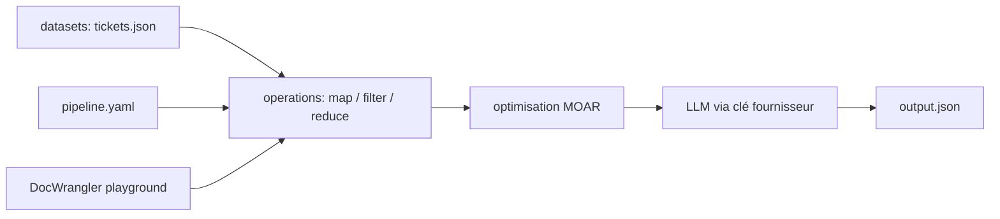

# ucbepic/docetl

> Declarative map-reduce pipelines over documents, each operation written in natural language.

## The problem
Processing a large corpus with an LLM means writing every call, wiring them together, then tuning accuracy by hand.
Cost and latency only show up afterwards.

## What it actually does
Ready-made operators — map, filter, reduce, resolve, split, gather, extract — orchestrated and parallelized.
Automatic pipeline optimization: model swapping, prompt rewriting, operation decomposition,
replacing a sub-task with code when possible. The result comes out as tables.
Two surfaces: a Python API for production and a declarative YAML; a DocWrangler UI for iterating.

## How it is wired


## Trying it
```bash
pip install docetl
export OPENAI_API_KEY=your_key   # or any LLM provider key
docetl run pipeline.yaml
```

## Cost and gotchas
Every operation calls an LLM: the bill is on you and grows with the number of documents.
Rate limits are declared in code (`docetl.rate_limits`); basic tests are advertised as costing under $0.01.

## What it is not
Not a database or a query engine: it produces tables, it does not store them.
Not deterministic — the optimizer can change the model and the prompt between two runs.
Not free in practice, despite the one-line install.

## Alternatives
No alternative named in the README.

## For you
The most directly useful of the batch for a data profile: measure on a hundred documents before launching a hundred thousand.
