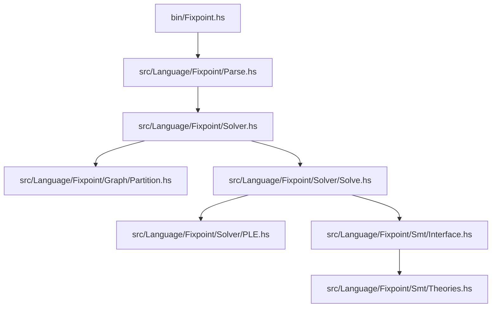

# ucsd-progsys/liquid-fixpoint

> Horn constraint solver for Liquid Types, backed by an SMT solver.

## The problem
Checking refinement types (Liquid Haskell) requires solving logical implication constraints.

## What it actually does
The executable reads constraints (.fq or Horn) and sends them to the solver, which partitions the graph and solves, through the SMT interface to Z3, CVC4, CVC5 or MathSat. It implements FUSION, PLE and REST. JSON options, stdin and partitioning.

## How it is wired


## Trying it
```bash
git clone https://github.com/ucsd-progsys/liquid-fixpoint.git
cd liquid-fixpoint
stack install
stack test
stack exec fixpoint -- tests/pos/adt.fq
```

## Cost and gotchas
You need an SMT solver (Z3, CVC4, CVC5 or MathSat) in the PATH and the Haskell toolchain. The `--extsolver` option is deprecated.

## What it is not
Not a standalone program verifier: a building block of Liquid Haskell, with strict invariants on its inputs.

## Alternatives
No alternative named.

## For you
Ignore: formal verification tool for Haskell, outside your domain.
