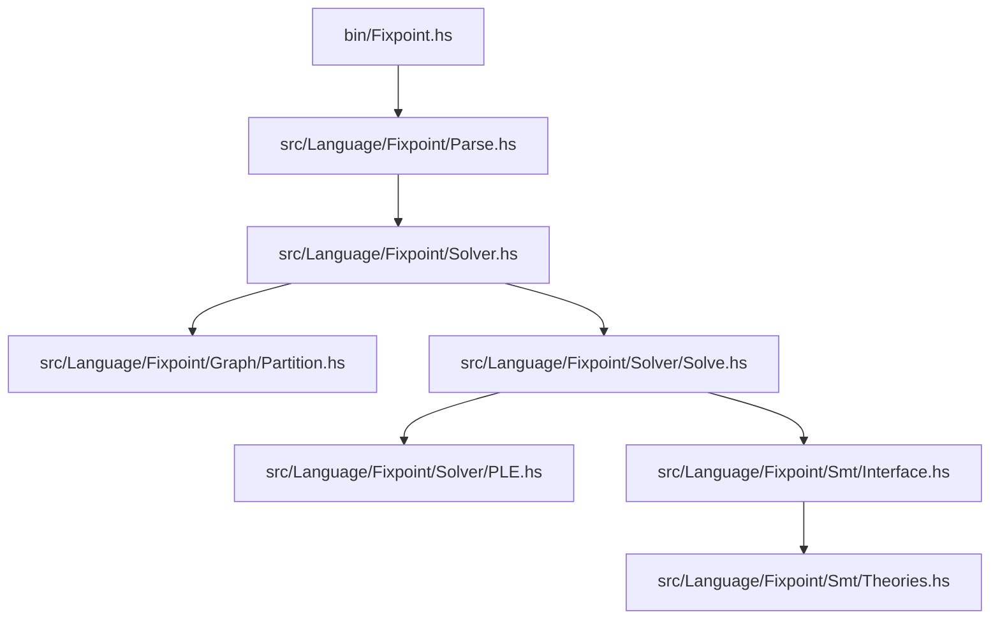

# ucsd-progsys/liquid-fixpoint

> Solveur de contraintes Horn pour les Liquid Types, qui s'appuie sur un solveur SMT.

## Le problème
Vérifier des types raffinés (Liquid Haskell) exige de résoudre des contraintes logiques d'implication.

## Ce que ça fait vraiment
L'exécutable lit des contraintes (.fq ou Horn), les envoie au solveur qui partitionne le graphe et résout, via l'interface SMT vers Z3, CVC4, CVC5 ou MathSat. Il implémente FUSION, PLE et REST. Options JSON, stdin et partitionnement.

## Comment c'est branché


## Essayer
```bash
git clone https://github.com/ucsd-progsys/liquid-fixpoint.git
cd liquid-fixpoint
stack install
stack test
stack exec fixpoint -- tests/pos/adt.fq
```

## Coût et pièges
Il faut un solveur SMT (Z3, CVC4, CVC5 ou MathSat) dans le PATH et la chaîne Haskell. L'option `--extsolver` est dépréciée.

## Ce que ce n'est pas
Pas un vérificateur de programmes utilisable seul : une brique de Liquid Haskell, avec des invariants stricts sur ses entrées.

## Alternatives
Aucune alternative nommée.

## Pour toi
À ignorer : outil de vérification formelle pour Haskell, hors de ton domaine.

