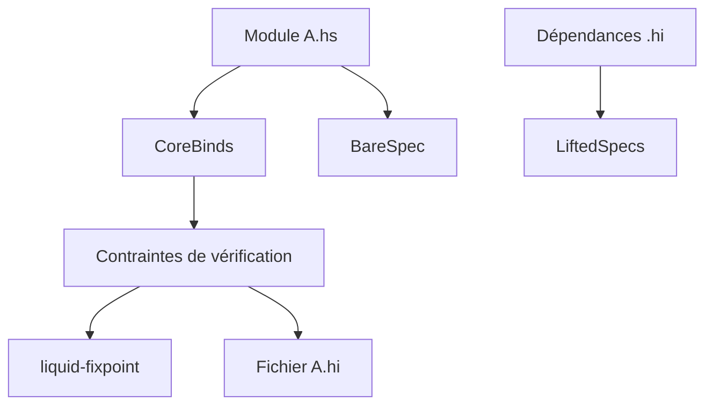

# ucsd-progsys/liquidhaskell

> Tool for formal verification of Haskell programs using refinement types, usable as a GHC plugin.

## The problem
Ordinary Haskell types cannot express properties such as "index within bounds" or "non-empty list", which remain runtime bugs.

## What it actually does
A GHC plugin that extracts the module's "core binds", generates verification constraints and hands them to `liquid-fixpoint` and an SMT solver (Z3 4.15.1 or later). If the module is verified, its specification is serialized into the `.hi` interface file. This repository is the development one; user-facing documentation is elsewhere.

## How it is wired


## Trying it
```
cabal install --lib liquidhaskell liquid-prelude liquid-vector --package-env . --force-reinstalls
ghc -fplugin=LiquidHaskell FILE.hs
```

## Cost and gotchas
Free. GHC 9.14.1, cabal 3.16.1.0 and Z3 are needed to build from GitHub; only one GHC is supported. Results vary depending on the dependencies already installed.

## What it is not
Not a tool for Python or ML: it only targets Haskell. 461 open issues.

## Alternatives
No alternative named in the README.

## For you
Ignore: Haskell formal verification, unrelated to data, AI or MLOps work.
