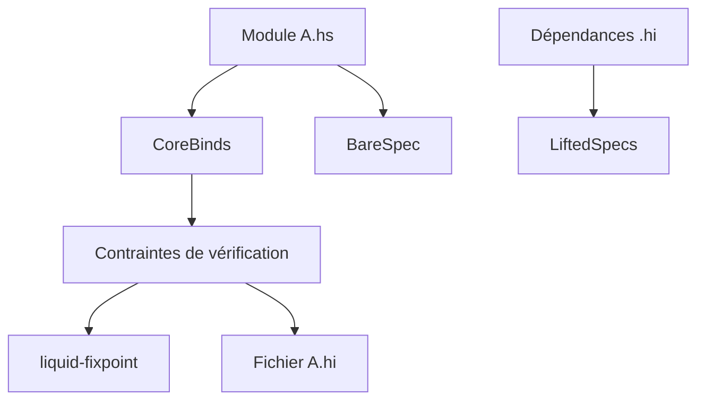

# ucsd-progsys/liquidhaskell

> Outil de vérification formelle de programmes Haskell par types raffinés, utilisable comme plugin GHC.

## Le problème
Les types Haskell ordinaires n'expriment pas des propriétés comme « index dans les bornes » ou « liste non vide », qui restent des bogues d'exécution.

## Ce que ça fait vraiment
Un plugin GHC qui extrait les « core binds » du module, génère des contraintes de vérification et les confie à `liquid-fixpoint` et à un solveur SMT (Z3 4.15.1 ou plus). Si le module est vérifié, sa spécification est sérialisée dans le fichier d'interface `.hi`. Ce dépôt est celui du développement ; la documentation destinée aux utilisateurs est ailleurs.

## Comment c'est branché


## Essayer
```
cabal install --lib liquidhaskell liquid-prelude liquid-vector --package-env . --force-reinstalls
ghc -fplugin=LiquidHaskell FILE.hs
```

## Coût et pièges
Gratuit. Il faut GHC 9.14.1, cabal 3.16.1.0 et Z3 pour compiler depuis GitHub ; un seul GHC est supporté. Les résultats varient selon les dépendances déjà installées.

## Ce que ce n'est pas
Pas un outil pour Python ou ML : il ne cible que Haskell. 461 issues ouvertes.

## Alternatives
Aucune alternative nommée dans le README.

## Pour toi
Ignorer : vérification formelle Haskell, sans lien avec un travail data, IA ou MLOps.

