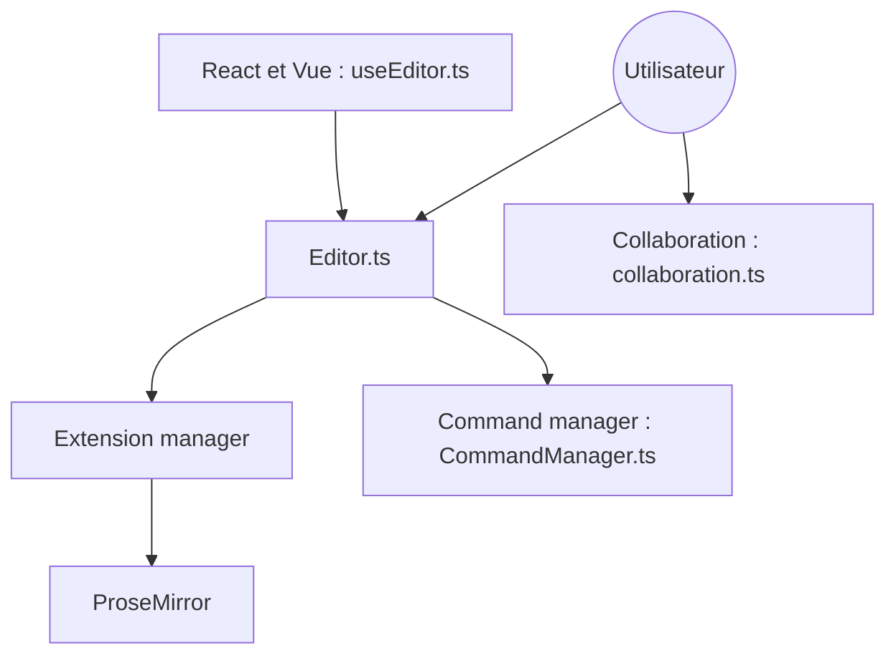

# ueberdosis/tiptap

> Headless rich-text editor based on ProseMirror, extensible, for web developers.

## The problem
Integrating a rich-text editor means fighting with an imposed interface that is hard to customize.

## What it actually does
A core handles schema, commands and editing state, with extensions (more than 100 according to the README). React and Vue adapters plug the editor in. Markdown and HTML conversion, collaboration via Yjs and Hocuspocus. An AI kit exists. An agent skill can be installed.

## How it is wired


## Trying it
```bash
npx skills add ueberdosis/tiptap --skill tiptap
```

## Cost and gotchas
The core is free. Pro extensions (advanced collaboration, comments, versions, document conversion, AI) require a subscription. Hocuspocus is the open source collaboration backend.

## What it is not
Not a ready-to-use editor: no interface is provided, only interface templates. Not entirely free for advanced features.

## Alternatives
No alternative named in the README.

## For you
Ignore for a data / AI / MLOps profile, unless you are building a web editing interface: the useful features (AI, collaboration) are partly paid.
