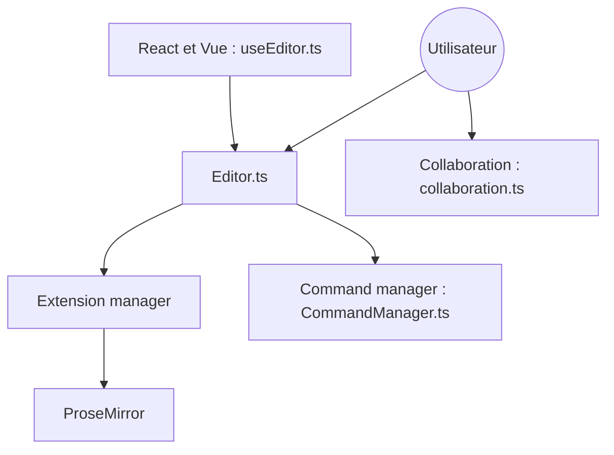

# ueberdosis/tiptap

> Éditeur de texte riche sans interface imposée, basé sur ProseMirror, extensible, pour développeurs web.

## Le problème
Intégrer un éditeur de texte riche demande de se battre avec une interface imposée et difficile à personnaliser.

## Ce que ça fait vraiment
Un cœur gère schéma, commandes et état d'édition, avec des extensions (plus de 100 selon le README). Des adaptateurs React et Vue branchent l'éditeur. Conversion Markdown et HTML, collaboration via Yjs et Hocuspocus. Un kit IA existe. Un skill d'agent est installable.

## Comment c'est branché


## Essayer
```bash
npx skills add ueberdosis/tiptap --skill tiptap
```

## Coût et pièges
Le cœur est gratuit. Les extensions Pro (collaboration avancée, commentaires, versions, conversion de documents, IA) demandent un abonnement. Hocuspocus est le backend open source de collaboration.

## Ce que ce n'est pas
Pas un éditeur prêt à l'emploi : aucune interface fournie, seulement des modèles d'interface. Pas entièrement gratuit pour les fonctions avancées.

## Alternatives
Aucune alternative nommée dans le README.

## Pour toi
À ignorer pour un profil data / IA / MLOps, sauf si tu bâtis une interface web d'édition : les fonctions utiles (IA, collaboration) sont en partie payantes.

