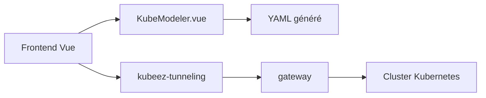

# uengine-oss/kubeez

> Web tool for visually composing and managing Kubernetes manifests, without writing YAML by hand.

## The problem
Writing Kubernetes manifests in YAML and operating them from the command line is off-putting for anyone unfamiliar with them.

## What it actually does
A visual editor that generates the YAML of Kubernetes objects (including Istio). Two modes: standalone (frontend only) or full, deployed in a cluster with a tunnel server and a gateway to manage your clusters. Adding an object amounts to creating a Vue component and its properties panel.

## How it is wired


## Trying it
```bash
npm install && npm run serve
docker run --name="kuberEz" -p 8081:8080 -d ohsy818/kuber-ez
kubectl create -f https://raw.githubusercontent.com/uengine-oss/kuber-ez/master/kubernetes/deploy.yaml
```

## Cost and gotchas
Free. Development cites Node 14.19.0, which is old, and Maven for the Java servers. The last push dates from November 2023.

## What it is not
It is not an industrial deployment tool: the full mode assumes installing its components in the cluster to be managed.

## Alternatives
No alternative named in the README.

## For you
Ignore: a project inactive since late 2023, with an old Node stack; for Kubernetes YAML in MLOps, a standard editor is enough.
