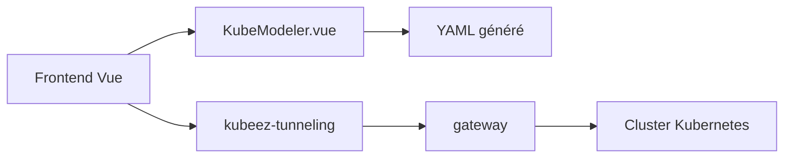

# uengine-oss/kubeez

> Outil web pour composer et gérer des manifestes Kubernetes visuellement, sans écrire de YAML à la main.

## Le problème
Écrire des manifestes Kubernetes en YAML et les opérer en ligne de commande est rebutant pour qui les connaît peu.

## Ce que ça fait vraiment
Un éditeur visuel qui génère le YAML des objets Kubernetes (y compris Istio). Deux modes : autonome (seulement le frontend) ou complet, déployé dans un cluster avec un serveur de tunnel et une passerelle pour gérer ses clusters. Ajouter un objet revient à créer un composant et son panneau de propriétés Vue.

## Comment c'est branché


## Essayer
```bash
npm install && npm run serve
docker run --name="kuberEz" -p 8081:8080 -d ohsy818/kuber-ez
kubectl create -f https://raw.githubusercontent.com/uengine-oss/kuber-ez/master/kubernetes/deploy.yaml
```

## Coût et pièges
Gratuit. Le développement cite Node 14.19.0, ancien, et Maven pour les serveurs Java. Le dernier push date de novembre 2023.

## Ce que ce n'est pas
Ce n'est pas un outil de déploiement industriel : le mode complet suppose d'installer ses composants dans le cluster à piloter.

## Alternatives
Aucune alternative nommée dans le README.

## Pour toi
À ignorer : projet peu actif depuis fin 2023, avec une pile Node ancienne ; pour du YAML Kubernetes en MLOps, un éditeur classique suffit.

