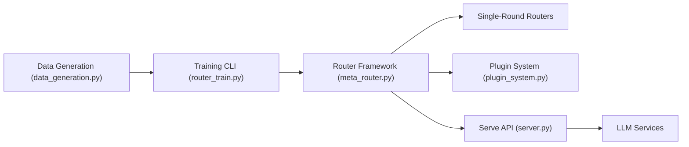

# ulab-uiuc/LLMRouter

> Research library to train and serve routers that pick the best LLM for each query.

## The problem
Sending every query to the biggest model is expensive; to the smallest, quality drops. You have to decide model by model, query by query.

## What it actually does
More than 16 routers (KNN, SVM, MLP, matrix factorization, Elo, graphs, custom, agentic) with an `llmrouter` CLI to train, infer and chat (Gradio). A pipeline generates data from 11 benchmarks, a plugin system lets you add your own routers, and an OpenAI-compatible server (OpenClaw Router) exists.

## How it is wired


## Trying it
```bash
pip install llmrouter-lib
llmrouter train --router knnrouter --config configs/model_config_train/knnrouter.yaml
llmrouter infer --router knnrouter --config config.yaml --query "What is machine learning?" --route-only
```

## Cost and gotchas
API keys (`API_KEYS` variable) are used for inference and data generation; NVIDIA provides some for free. Training some routers requires a GPU. `--route-only` avoids any paid call.

## What it is not
Not a production-ready gateway: it is a research framework. The xRouteBench benchmark replays pre-recorded runs, it does not measure your own models.

## Alternatives
- RouteLLM: work that several routers draw inspiration from.
- RouterDC, AutoMix, GraphRouter: methods reused as routers.

## For you
Watch: relevant if you compare model routing strategies; of little use if you just want a gateway.
