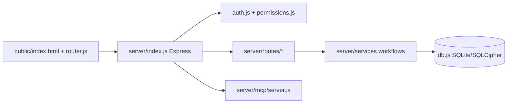

# ulsklyc/yuvomi

> Self-hosted household management application (tasks, budget, meals, health), for families and couples.

## The problem
A household glues together a dozen paid apps, each with its own account, subscription and data held by a third party.

## What it actually does
Twenty separately switchable modules: tasks, calendar, shopping, meals, pantry, budget, documents, health, reminders, backups. The modules interlock: the meal plan feeds the shopping list, a receipt attaches to the transaction. Node.js/Express server, framework-free PWA client, a SQLite database with optional SQLCipher encryption. An MCP endpoint and an OpenAPI spec exist for agents.

## How it is wired


## Trying it
```bash
curl -O https://raw.githubusercontent.com/ulsklyc/yuvomi/main/docker-compose.yml
curl -O https://raw.githubusercontent.com/ulsklyc/yuvomi/main/.env.example
cp .env.example .env
openssl rand -hex 32   # SESSION_SECRET
openssl rand -hex 32   # DB_ENCRYPTION_KEY
docker compose up -d
```

## Cost and gotchas
Free, 256 MB of RAM, port 3000. The encryption key is unrecoverable if lost. Document binaries (folder, WebDAV, Drive) are not in the basic backups. Health data: to be encrypted, and GDPR compliance is your responsibility.

## What it is not
Not a medical device. Not a tool for teams: designed for two to six people. Formerly named Oikos (renamed because of a trademark conflict).

## Alternatives
Mealie or Tandoor for recipes alone (the README can mirror them read-only).

## For you
Ignore: a household tool outside the data/AI/MLOps scope; only the MCP endpoint has any curiosity value.
