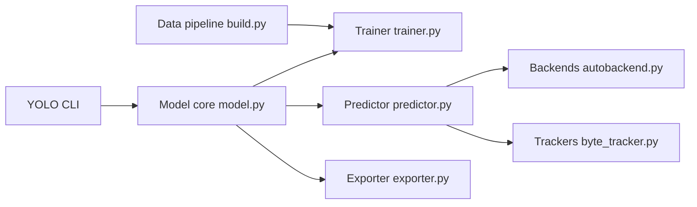

# ultralytics/ultralytics

> YOLO library and CLI to train, evaluate, predict and export vision models.

## The problem
Chaining detection, segmentation, pose, tracking and export to ONNX/TensorRT otherwise requires several repositories and a lot of glue.

## What it actually does
A single `YOLO(...)` / `yolo` interface for train, val, predict, track, export, benchmark.
Tasks: detection, instance and semantic segmentation, depth, classification, pose, OBB; ByteTrack/BoT-SORT tracking.
Export to ONNX, TensorRT, OpenVINO, CoreML, TFLite, NCNN… via `exporter.py` and `autobackend.py`.
"Solutions" layer: counting, heatmaps, speed estimation; W&B, MLflow, Comet, ClearML callbacks.

## How it is wired


## Trying it
```bash
pip install ultralytics
yolo predict model=yolo26n.pt source='https://ultralytics.com/images/bus.jpg'
yolo val detect data=coco.yaml device=0
```

## Cost and gotchas
Free under AGPL-3.0; any closed commercial use requires a paid Enterprise license. GPU useful for training; weights downloaded on first use.

## What it is not
Not free to integrate into a proprietary product without a license. YOLO27 announced but not available. The Ultralytics Hub is an optional remote service.

## Alternatives
Not documented: no alternative repository named in the README.

## For you
Reference for vision; adopt internally, settle the AGPL question before any client deliverable.
