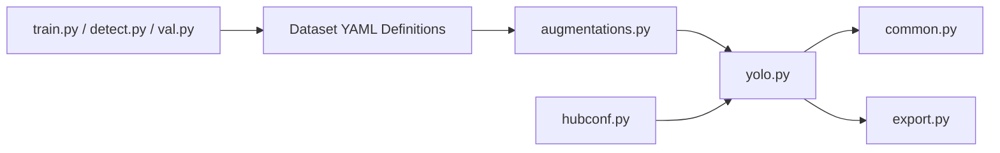

# ultralytics/yolov5

> PyTorch model for image detection, segmentation and classification, for those deploying vision.

## The problem
Training and deploying an object detector means gluing together data, model, metrics and export to ONNX/TensorRT by hand.

## What it actually does
Scripts `train.py`, `detect.py`, `val.py`, `export.py`, plus `segment/` and `classify/` variants.
Models described in YAML (`models/`), datasets and hyperparameters in YAML (`data/`).
Loading via PyTorch Hub (`hubconf.py`), export to ONNX/CoreML/TensorRT, W&B, Comet and ClearML loggers.
The README itself points to the `ultralytics` package for recent architectures.

## How it is wired


## Trying it
```bash
git clone https://github.com/ultralytics/yolov5
cd yolov5
pip install -r requirements.txt
python detect.py --weights yolov5s.pt --source img.jpg
```

## Cost and gotchas
Python ≥ 3.8, PyTorch ≥ 1.8. COCO training: 1 to 8 days on a V100 depending on size. AGPL-3.0: paid Enterprise license for closed use.

## What it is not
Not the current Ultralytics generation: pose, OBB and the unified CLI are in `ultralytics`. The AGPL taints a distributed product.

## Alternatives
- ultralytics (`ultralytics` package): recent YOLO models, Python interface and unified CLI.

## For you
A stable reference for detection, but go with `ultralytics` for a new project and check the AGPL.
