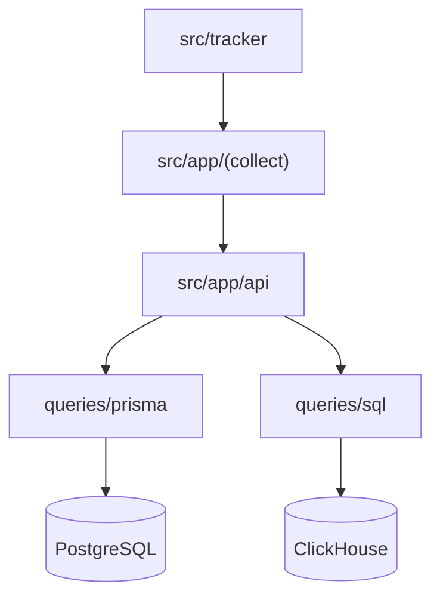

# umami-software/umami

> Privacy-friendly, cookie-free, self-hostable web analytics platform.

## The problem
Measuring traffic and conversions without cookies or sending data to a third party.

## What it actually does
A browser tracker sends page views and events (and session recordings) to collection routes. Metadata goes into PostgreSQL, high-volume events into ClickHouse (optional). Reports: funnels, retention, attribution, revenue, public shares.

## How it is wired


## Trying it
```bash
git clone https://github.com/umami-software/umami.git
cd umami
pnpm install
pnpm run build
pnpm run start
docker compose up -d
```
Create `.env` with `DATABASE_URL`.

## Cost and gotchas
Free when self-hosted: server, PostgreSQL 12.14+ and Node 18.18+. The initial account is `admin` / `umami`: change it. MCP disabled by default.

## What it is not
Not a general-purpose BI tool. ClickHouse is not required by the README (undocumented).

## Alternatives
No alternative named in the README.

## For you
Worth adopting to track the usage of a site or documentation without cookies; the default password is the trap to fix.
