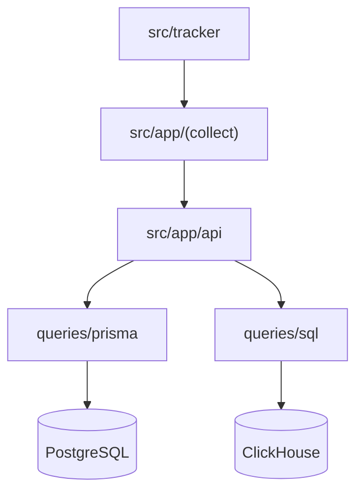

# umami-software/umami

> Plateforme d'analyse web respectueuse de la vie privée, sans cookies, auto-hébergeable.

## Le problème
Mesurer le trafic et les conversions sans cookies ni envoi de données à un tiers.

## Ce que ça fait vraiment
Un traqueur navigateur envoie pages vues et événements (et enregistrements de sessions) à des routes de collecte. Les métadonnées vont dans PostgreSQL, les événements en volume dans ClickHouse (optionnel). Rapports : funnels, rétention, attribution, revenus, partages publics.

## Comment c'est branché


## Essayer
```bash
git clone https://github.com/umami-software/umami.git
cd umami
pnpm install
pnpm run build
pnpm run start
docker compose up -d
```
Créer `.env` avec `DATABASE_URL`.

## Coût et pièges
Gratuit auto-hébergé : serveur, PostgreSQL 12.14+ et Node 18.18+. Le compte initial est `admin` / `umami` : à changer. MCP désactivé par défaut.

## Ce que ce n'est pas
Pas un outil de BI généraliste. ClickHouse n'est pas exigé par le README (non documenté).

## Alternatives
Aucune alternative nommée dans le README.

## Pour toi
À adopter pour tracer l'usage d'un site ou d'une documentation sans cookies ; le mot de passe par défaut est le piège à corriger.

