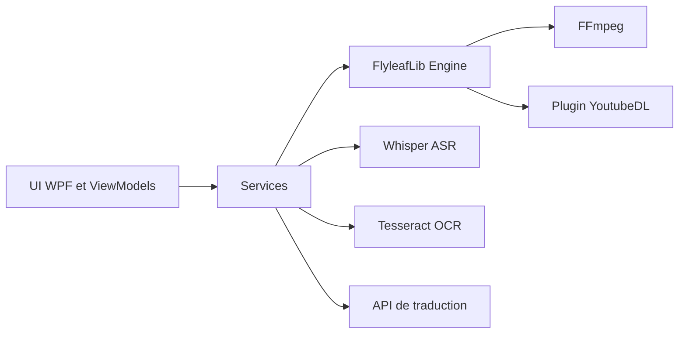

# umlx5h/LLPlayer

> Windows media player for language learning, with dual subtitles, Whisper ASR and live translation.

## The problem
Classic players offer neither bilingual subtitles, nor subtitle generation, nor word lookup during playback.

## What it actually does
A WPF/C# application built on FlyleafLib (FFmpeg): dual subtitles, local transcription via whisper.cpp or faster-whisper, OCR of bitmap subtitles, translation (Google, DeepL, Ollama, LM Studio, OpenAI) including by contextual LLM, a subtitle sidebar, playback of online videos via yt-dlp. Customizable shortcuts and dark theme.

## How it is wired


## Trying it
```bash
git clone git@github.com:umlx5h/LLPlayer.git
# ouvrir ./LLPlayer.slnx dans Visual Studio ou Rider, puis compiler
# ou télécharger un build depuis les Releases et lancer LLPlayer.exe
```

## Cost and gotchas
Windows 10/11 x64, .NET Desktop Runtime 10 and Visual C++ Redistributable (otherwise a crash when enabling ASR or OCR). CUDA or Vulkan GPU recommended. DeepL or OpenAI: key and bill at your expense.

## What it is not
Not cross-platform (Linux/macOS not supported) and Beta status with breaking changes planned.

## Alternatives
- VLC: general-purpose player compared in the README.
- Language Reactor: browser extension that inspires the project.

## For you
Ignore: a language-learning application on Windows; the only AI interest is the local Whisper chain plus translation by a local LLM.
