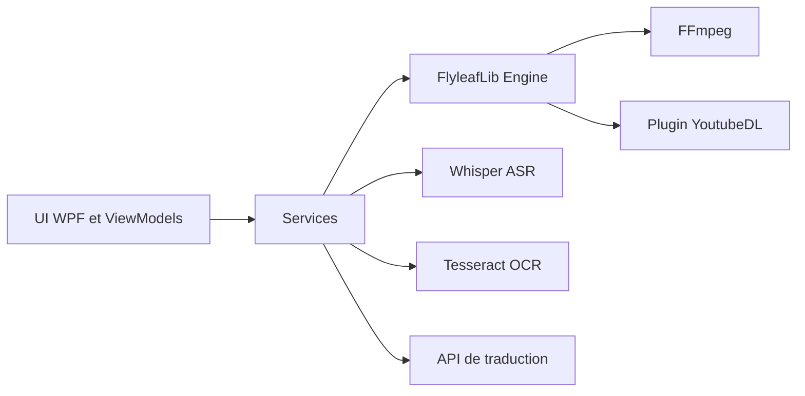

# umlx5h/LLPlayer

> Lecteur multimédia Windows pour apprendre une langue, avec sous-titres doubles, ASR Whisper et traduction en direct.

## Le problème
Les lecteurs classiques n'offrent ni sous-titres bilingues, ni génération de sous-titres, ni consultation de mots pendant la lecture.

## Ce que ça fait vraiment
Application WPF/C# fondée sur FlyleafLib (FFmpeg) : sous-titres doubles, transcription locale par whisper.cpp ou faster-whisper, OCR de sous-titres bitmap, traduction (Google, DeepL, Ollama, LM Studio, OpenAI) y compris par LLM contextuel, barre latérale de sous-titres, lecture de vidéos en ligne via yt-dlp. Raccourcis personnalisables et thème sombre.

## Comment c'est branché


## Essayer
```bash
git clone git@github.com:umlx5h/LLPlayer.git
# ouvrir ./LLPlayer.slnx dans Visual Studio ou Rider, puis compiler
# ou télécharger un build depuis les Releases et lancer LLPlayer.exe
```

## Coût et pièges
Windows 10/11 x64, .NET Desktop Runtime 10 et Visual C++ Redistributable (sinon plantage à l'activation d'ASR ou OCR). GPU CUDA ou Vulkan conseillé. DeepL ou OpenAI : clé et facture à ta charge.

## Ce que ce n'est pas
Pas multiplateforme (Linux/macOS non pris en charge) et statut Beta avec changements incompatibles prévus.

## Alternatives
- VLC : lecteur généraliste comparé dans le README.
- Language Reactor : extension navigateur qui inspire le projet.

## Pour toi
À ignorer : application d'apprentissage des langues sous Windows ; seul intérêt côté IA, la chaîne Whisper locale plus traduction par LLM local.

