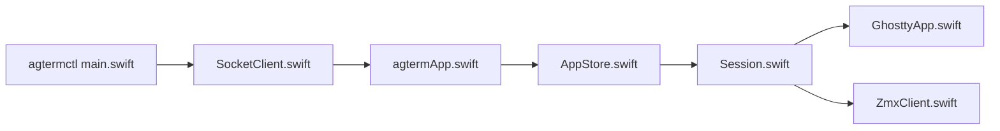

# umputun/agterm

> Minimalist macOS terminal with a control API, designed to drive several coding agents in parallel.

## The problem
With several concurrent coding agents, a tabbed terminal quickly loses track of which one is active, blocked or finished.

## What it actually does
Windows, named workspaces and sessions; splits, scratch, overlays. `agtermctl` drives everything through a local socket: create sessions, type into them, read the text, set a status. Three restore modes (including live processes via zmx). Status hooks for Claude Code, Codex, etc. Terminal engine: libghostty.

## How it is wired


## Trying it
```bash
brew install --cask umputun/apps/agterm
agtermctl session new --workspace "$ws" --cwd "$PWD" --no-select
agtermctl session status blocked --target "$sid"
agtermctl tree --json
```

## Cost and gotchas
Free. Apple Silicon, macOS 14+. The "live sessions" mode requires zsh as the login shell.

## What it is not
No deep agent integration, by design. Not cross-platform (independent Linux/Windows ports).

## Alternatives
- agterm-linux and agwinterm: third-party ports for Linux and Windows.
- Rook: a fork oriented toward out-of-scope features.

## For you
Worth watching: useful if you orchestrate several agents on a Mac; otherwise a classic terminal is enough.
