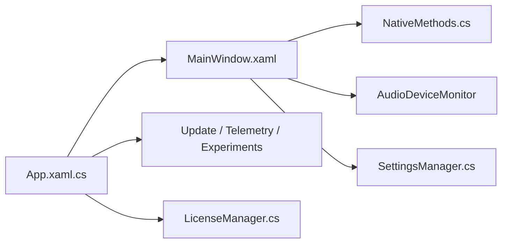

# unchihugo/FluentFlyout

> Media flyouts, lock keys and a taskbar widget in Windows 11 style.

## The problem
Windows' media and lock-key popups are impractical and barely customizable.

## What it actually does
WPF application in the notification area: audio flyout (cover art, title, controls), "Up Next", lock-key status, taskbar widget, volume mixer. Mica, light/dark themes. Per the code, update services, telemetry and experiments; optional Store license (about €2.99).

## How it is wired

## Trying it
No documented command: install via the Microsoft Store or the `.msixbundle` installer (certificate to import).

## Cost and gotchas
The GitHub version is free and complete; the Store version unlocks a few paid options. The code contains a `TelemetryService` not explained by the README.

## What it is not
Not cross-platform; not a music player.

## Alternatives
No alternative named in the README.

## For you
Ignore: a Windows desktop utility unrelated to your field.
