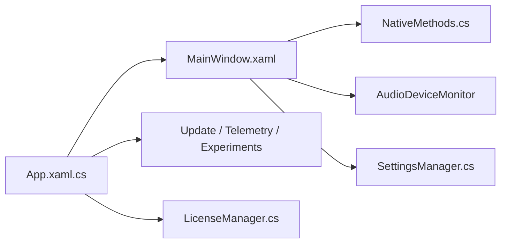

# unchihugo/FluentFlyout

> Flyouts média, touches verrouillage et widget barre des tâches au style Windows 11.

## Le problème
Les popups média et touches de verrouillage de Windows sont peu pratiques et peu personnalisables.

## Ce que ça fait vraiment
Application WPF dans la zone de notification : flyout audio (pochette, titre, contrôles), « Up Next », état des touches verrouillage, widget de barre des tâches, mélangeur de volume. Mica, thèmes clair/sombre. D'après le code, services de mise à jour, télémétrie et expérimentations ; licence Store optionnelle (≈2,99 €).

## Comment c'est branché

## Essayer
Aucune commande documentée : installation par Microsoft Store ou installeur `.msixbundle` (certificat à importer).

## Coût et pièges
Version GitHub gratuite et complète ; la version Store débloque quelques options payantes. Le code contient un `TelemetryService` non expliqué par le README.

## Ce que ce n'est pas
Pas multiplateforme ; pas un lecteur de musique.

## Alternatives
Aucune alternative nommée dans le README.

## Pour toi
À ignorer : utilitaire de bureau Windows sans lien avec ton métier.

