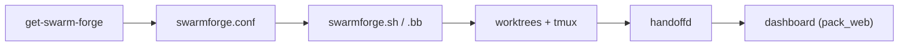

# unclebob/swarm-forge

> Coordinates AI agents in git worktrees and tmux sessions, with work handoff and a dashboard.

## The problem
Getting several coding agents to work in a chain (specify, code, clean up) without overwriting each other.

## What it actually does
Each agent role has its own git worktree and tmux session. Roles pass committed work to one another via durable handoffs, and a local dashboard handles approvals and clarifications. Packs of 2, 4 or 6 roles, or multi-project "forges". Backends: grok, codex, claude, copilot.

## How it is wired
Simplified diagram based on the sheet, no diagram provided.



## Trying it
```bash
get-swarm-forge six-pack
./swarm
```

## Cost and gotchas
Requires zsh, git, tmux, Babashka and at least one agent backend: your calls are billed by those services. The README warns not to spend anything on a "SWARM" token from bankrbot.

## What it is not
It is not a product directly runnable from `main`: only the installer and runtime live there, the products are on branches. No license is declared.

## Alternatives
No alternative named in the README.

## For you
Worth watching: the idea of chained agents is interesting, but the lack of a license and the young single-person project hold back adoption.
