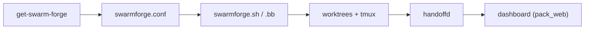

# unclebob/swarm-forge

> Coordonne des agents IA dans des worktrees git et sessions tmux, avec passation de travail et tableau de bord.

## Le problème
Faire travailler plusieurs agents de code en chaîne (spécifier, coder, nettoyer) sans qu'ils s'écrasent mutuellement.

## Ce que ça fait vraiment
Chaque rôle d'agent a son worktree git et sa session tmux. Les rôles se passent du travail commité via des handoffs durables, et un tableau de bord local gère approbations et clarifications. Packs de 2, 4 ou 6 rôles, ou « forges » multi-projets. Backends : grok, codex, claude, copilot.

## Comment c'est branché
Schéma simplifié d'après la fiche, sans diagramme fourni.



## Essayer
```bash
get-swarm-forge six-pack
./swarm
```

## Coût et pièges
Il faut zsh, git, tmux, Babashka et au moins un backend d'agent : tes appels sont facturés par ces services. Le README avertit de ne rien dépenser pour un jeton « SWARM » de bankrbot.

## Ce que ce n'est pas
Ce n'est pas un produit directement exécutable depuis `main` : seul l'installeur et le runtime y vivent, les produits sont sur des branches. Aucune licence n'est déclarée.

## Alternatives
Aucune alternative nommée dans le README.

## Pour toi
À surveiller : l'idée d'agents en chaîne est intéressante, mais l'absence de licence et le projet jeune d'une seule personne freinent l'adoption.

