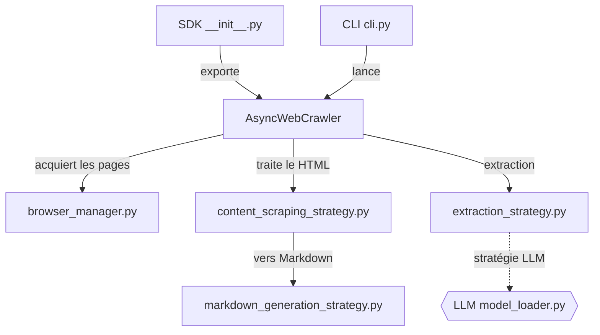

# unclecode/crawl4ai

> Asynchronous web crawler in Python that transforms web pages into clean Markdown or structured JSON for Retrieval-Augmented Generation (RAG).

## The problem
Extracting the useful text from a website (JavaScript, banners, menus) to feed a large language model requires manual assembly: using a browser, cleaning the data, and extracting the relevant parts.

## What it actually does
`AsyncWebCrawler` controls a Playwright browser, then cleans the HTML and generates Markdown, with a "filter" function that removes unnecessary elements. Extraction is performed using CSS/XPath selectors without an LLM, or with any LiteLLM provider. It manages sessions, proxies, persistent profiles, depth-first and breadth-first crawling, and multi-URL handling. A Docker FastAPI server with a Redis file and a paid cloud service are also available.

## How it is wired


## Trying it
```bash
pip install -U crawl4ai
crawl4ai-setup
crawl4ai-doctor
crwl https://news.ycombinator.com -o markdown
```

## Cost and gotchas
The library is available under the Apache-2.0 license, but you are responsible for providing the browser and infrastructure. Extracting data using an LLM requires a key from your provider. The README file requires attribution (e.g., a badge or text line) when using the project.

## What it is not
This is not the Crawl4AI Cloud service, which is hosted and requires payment for usage exceeding 1,000 credits per month. It does not reliably bypass anti-bot protections: you need to configure proxies and incognito mode.

## Alternatives
No alternative is mentioned in the README, except for the cloud offering from the same author.

## For you
Suitable for powering a RAG (Retrieval-Augmented Generation) chain using clean Markdown: a mature library, a permissive license, and a clear path to Docker or the cloud.
