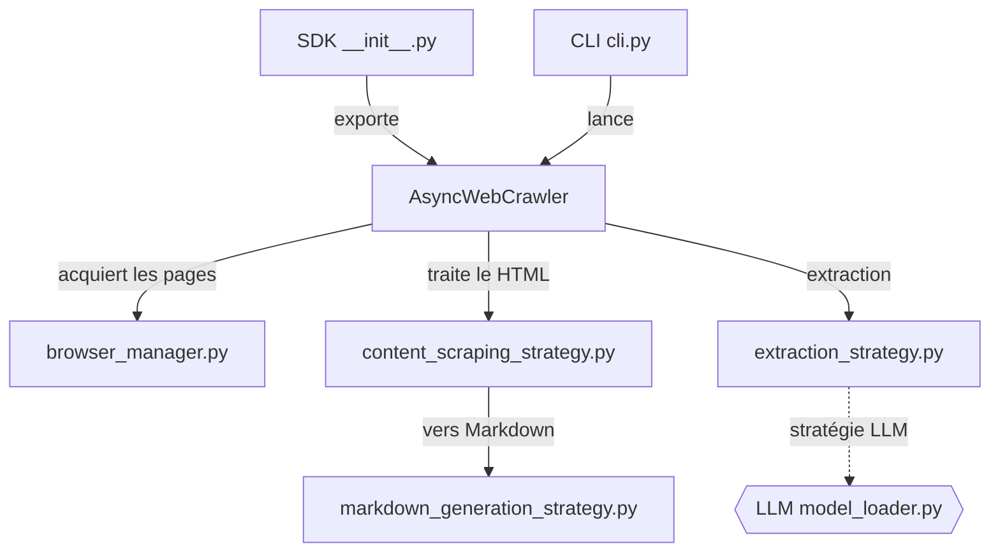

# unclecode/crawl4ai

> Crawler web asynchrone en Python qui transforme des pages en Markdown propre ou en JSON structuré pour la RAG.

## Le problème
Extraire le texte utile d'un site (JavaScript, bandeaux, menus) pour alimenter un LLM demande de l'assembler soi-même : navigateur, nettoyage, découpage.

## Ce que ça fait vraiment
`AsyncWebCrawler` pilote un navigateur Playwright, puis nettoie le HTML et produit du Markdown, avec un filtre « fit » qui retire le superflu. L'extraction se fait par schémas CSS/XPath sans LLM, ou avec n'importe quel fournisseur LiteLLM. Il gère les sessions, proxys, profils persistants, le parcours profond (BFS, DFS) et le multi-URL. Un serveur Docker FastAPI avec file Redis et un service cloud payant existent aussi.

## Comment c'est branché


## Essayer
```bash
pip install -U crawl4ai
crawl4ai-setup
crawl4ai-doctor
crwl https://news.ycombinator.com -o markdown
```

## Coût et pièges
La bibliothèque est gratuite sous Apache-2.0, mais le navigateur et l'infrastructure sont à ta charge. L'extraction par LLM demande une clé de ton fournisseur. Le README impose une attribution (badge ou ligne de texte) quand on utilise le projet.

## Ce que ce n'est pas
Ce n'est pas le service Crawl4AI Cloud, qui est hébergé et payant au-delà de 1 000 crédits par mois. Il ne contourne pas à coup sûr les protections anti-bot : tu règles proxys et mode furtif.

## Alternatives
Aucune alternative nommée dans le README, hormis l'offre cloud du même auteur.

## Pour toi
À adopter pour alimenter une chaîne RAG en Markdown propre : bibliothèque mature, licence permissive, et un chemin clair vers le Docker ou le cloud.

