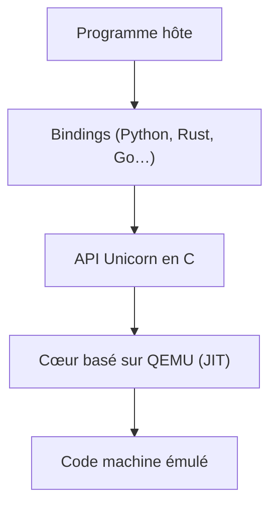

# unicorn-engine/unicorn

> Multi-architecture CPU emulator based on QEMU, for security researchers and reverse engineers.

## The problem
Running a piece of machine code from another architecture forces you to emulate an entire machine.

## What it actually does
Emulates ARM, ARM64, M68K, MIPS, PowerPC, RISCV, SPARC, S390X, TriCore and x86 with a neutral C API, just-in-time compilation (JIT) and fine-grained instrumentation. Bindings exist for Python, Rust, Java, Go, among others. The README points to `docs/COMPILE.md` for building.

## How it is wired
Simplified diagram based on the fiche, no diagram provided.



## Trying it
```bash
# Aucune commande dans le README : voir docs/COMPILE.md.
```

## Cost and gotchas
Free. A C compiler is required, but it is missing from the prerequisites list: `[aucun]`. GPL-2.0 license: a program that links it is subject to its terms. The README asks for contributors.

## What it is not
Not a full system emulator: a framework for running CPU code. Usage geared toward binary analysis.

## Alternatives
No alternative named in the README.

## For you
Ignore: CPU emulation for reverse engineering, outside your data / AI / MLOps work, except for binary analysis.
