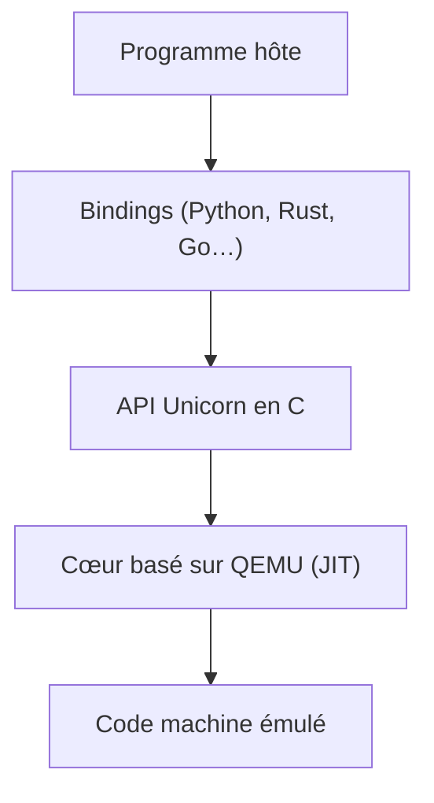

# unicorn-engine/unicorn

> Émulateur de processeur multi-architectures basé sur QEMU, pour chercheurs en sécurité et ingénieurs inverses.

## Le problème
Exécuter un bout de code machine d'une autre architecture oblige à émuler toute une machine.

## Ce que ça fait vraiment
Émule ARM, ARM64, M68K, MIPS, PowerPC, RISCV, SPARC, S390X, TriCore et x86 avec une API neutre en C, compilation à la volée (JIT) et instrumentation fine. Des bindings existent pour Python, Rust, Java, Go, entre autres. Le README renvoie à `docs/COMPILE.md` pour la compilation.

## Comment c'est branché
Schéma simplifié d'après la fiche, sans diagramme fourni.



## Essayer
```bash
# Aucune commande dans le README : voir docs/COMPILE.md.
```

## Coût et pièges
Gratuit. Un compilateur C est nécessaire, absent de la liste des prérequis : `[aucun]`. Licence GPL-2.0 : un programme qui la lie en subit les conditions. Le README demande des contributeurs.

## Ce que ce n'est pas
Pas un émulateur de système complet : un cadre pour exécuter du code CPU. Usage orienté analyse de binaires.

## Alternatives
Aucune alternative nommée dans le README.

## Pour toi
À ignorer : émulation CPU pour rétro-ingénierie, hors de ton travail data / IA / MLOps, sauf analyse de binaires.

