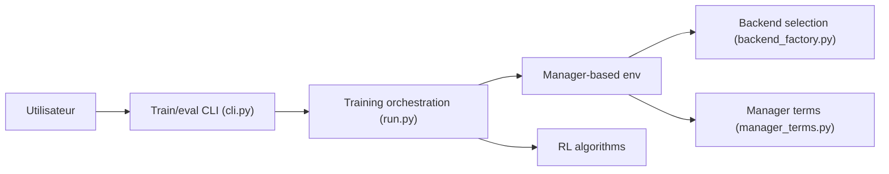

# unilabsim/UniLab

> Configurable infrastructure for reinforcement learning in robotics, independent of simulator and hardware.

## The problem
Switching simulator or graphics card often forces you to rewrite the environments and the training flow.

## What it actually does
- Describes tasks, actions, observations, rewards and terminations as "terms" assembled in Hydra YAML.
- Picks the simulator with `--sim` (for example Motrix, MuJoCo) behind a `SimBackend` contract.
- Separates solver and learner: CPU or external simulation, learning on CUDA, ROCm, MPS or XPU.
- FastSAC/FlashSAC: collection and update overlap; the paper reports a 3 to 10 times gain on representative configurations.

## How it is wired


## Trying it
```bash
curl -LsSf https://astral.sh/uv/install.sh | sh
git clone https://github.com/unilabsim/UniLab.git
cd UniLab
make setup
uv run demo dance
uv run train --algo ppo --task go2_joystick_flat --sim motrix
uv run eval --algo ppo --task go2_joystick_flat --sim motrix --load-run -1
```

## Cost and gotchas
Free; checkpoints and assets are downloaded from Hugging Face on first launch. Maturity of backends and tasks is "evaluated by evidence": consult the support matrix before choosing a combination. 33 open issues.

## What it is not
Not a simulator: it orchestrates them. Not a turnkey tool for a real robot: sim-to-sim is documented, not hardware.

## Alternatives
Isaac Lab and mjlab, cited as sources of inspiration in the README.

## For you
Worth watching: interesting if you do reinforcement learning in robotics; otherwise too specialized.
