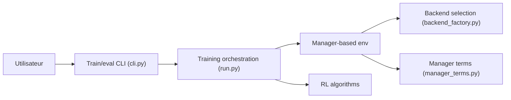

# unilabsim/UniLab

> Infrastructure configurable pour l'apprentissage par renforcement en robotique, indépendante du simulateur et du matériel.

## Le problème
Changer de simulateur ou de carte graphique oblige souvent à réécrire les environnements et le flux d'entraînement.

## Ce que ça fait vraiment
- Décrit tâches, actions, observations, récompenses et terminaisons comme des « termes » assemblés en YAML Hydra.
- Choisit le simulateur avec `--sim` (par exemple Motrix, MuJoCo) derrière un contrat `SimBackend`.
- Sépare solveur et apprenant : simulation CPU ou externe, apprentissage sur CUDA, ROCm, MPS ou XPU.
- FastSAC/FlashSAC : collecte et mise à jour se chevauchent ; l'article annonce 3 à 10 fois de gain sur des configurations représentatives.

## Comment c'est branché


## Essayer
```bash
curl -LsSf https://astral.sh/uv/install.sh | sh
git clone https://github.com/unilabsim/UniLab.git
cd UniLab
make setup
uv run demo dance
uv run train --algo ppo --task go2_joystick_flat --sim motrix
uv run eval --algo ppo --task go2_joystick_flat --sim motrix --load-run -1
```

## Coût et pièges
Gratuit ; checkpoints et assets téléchargés depuis Hugging Face au premier lancement. Maturité des backends et tâches « évaluée par preuves » : consulter la matrice de support avant de choisir une combinaison. 33 issues ouvertes.

## Ce que ce n'est pas
Pas un simulateur : il en orchestre. Pas un outil pour robot réel clé en main : le sim-to-sim est documenté, pas le matériel.

## Alternatives
Isaac Lab et mjlab, cités comme sources d'inspiration dans le README.

## Pour toi
À surveiller : intéressant si tu fais de l'apprentissage par renforcement en robotique ; sinon trop spécialisé.

