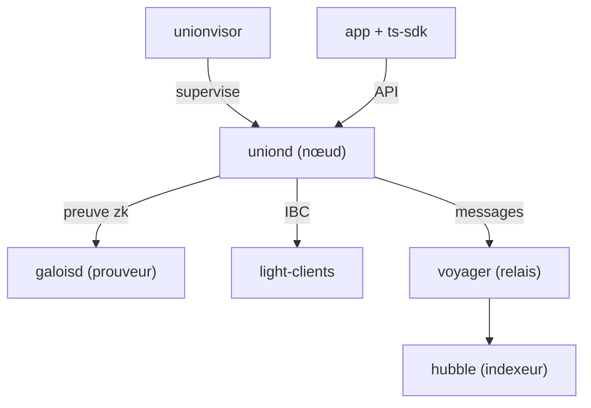

# unionlabs/union

> Zero-knowledge-proof blockchain infrastructure for transferring messages and assets between chains, for Web3 developers.

## The problem
Connecting blockchains often forces you to trust oracles or multiple signatures. Union aims for verification with no trusted third party.

## What it actually does
Monorepo of several components: `uniond` node (Go), `galoisd` prover (Go, Gnark), `voyager` relayer (Rust), light clients, CosmWasm and EVM contracts, `hubble` indexer, web application, website and TypeScript SDK. It implements IBC for Cosmos and connects to EVM chains.

## How it is wired


## Trying it
```bash
nix build .#uniond -L
nix build .#voyager -L
nix develop
```

## Cost and gotchas
The README requires Nix to build (install curl command provided); some components only compile on Linux, and macOS goes through a NixOS VM (OrbStack). Go, Rust and Solidity stack.

## What it is not
Not a lightweight library: it is a full protocol, with decentralized governance planned.

## Alternatives
No alternative named in the README.

## For you
Ignore: cross-chain relayer unrelated to data, AI or MLOps.
