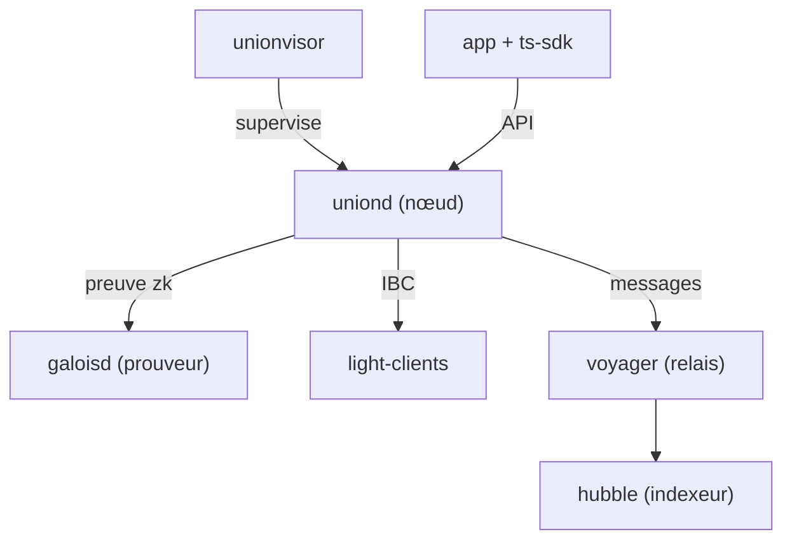

# unionlabs/union

> Infrastructure blockchain à preuves à divulgation nulle pour transférer messages et actifs entre chaînes, pour développeurs Web3.

## Le problème
Relier des blockchains oblige souvent à faire confiance à des oracles ou à des signatures multiples. Union vise une vérification sans tiers de confiance.

## Ce que ça fait vraiment
Monorepo de plusieurs briques : nœud `uniond` (Go), prouveur `galoisd` (Go, Gnark), relais `voyager` (Rust), clients légers, contrats CosmWasm et EVM, indexeur `hubble`, application web, site et SDK TypeScript. Il implémente IBC pour Cosmos et se connecte à des chaînes EVM.

## Comment c'est branché


## Essayer
```bash
nix build .#uniond -L
nix build .#voyager -L
nix develop
```

## Coût et pièges
Le README impose Nix pour construire (curl d'installation fourni) ; certaines briques ne compilent que sous Linux, macOS passe par une VM NixOS (OrbStack). Stack Go, Rust et Solidity.

## Ce que ce n'est pas
Pas une bibliothèque légère : c'est un protocole complet, avec gouvernance décentralisée prévue.

## Alternatives
Aucune alternative nommée dans le README.

## Pour toi
À ignorer : relais inter-chaînes sans lien avec la data, l'IA ou le MLOps.

