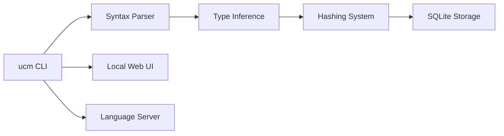

# unisonweb/unison

> Typed functional language where code is identified by its hash, for the curious about distributed programming.

## The problem
Slow compilation, breaking renames and merge conflicts caused by formatting.

## What it actually does
A statically typed language with effects; definitions are stored as ASTs addressed by their hash in a database, which gives perfect incremental compilation, non-breaking renaming, caching of deterministic tests, and semantic merging. Codebase server, LSP, MCP server for AI agents; Unison Cloud for distributed systems.

## How it is wired


## Trying it
```bash
git clone https://github.com/unisonweb/unison.git
cd unison
stack --version
stack build --fast --test && stack exec unison
```

## Cost and gotchas
Built with Stack (Haskell). License "present but not identified by GitHub": to be checked. 1,301 open issues.

## What it is not
Not an established data science language: no ML libraries mentioned.

## Alternatives
No alternative named in the README.

## For you
Keep an eye on it out of technical curiosity: interesting model, but no obvious data/AI use.
