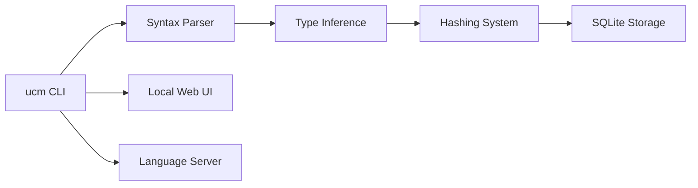

# unisonweb/unison

> Langage fonctionnel typé où le code est identifié par son empreinte, pour curieux de la programmation distribuée.

## Le problème
Compilation lente, renommages cassants et conflits de fusion dus à la mise en forme.

## Ce que ça fait vraiment
Langage statiquement typé à effets ; les définitions sont stockées comme AST adressés par leur hash dans une base, ce qui donne compilation incrémentale parfaite, renommage non cassant, mise en cache des tests déterministes, fusion sémantique. Serveur de codebase, LSP, serveur MCP pour agents IA ; Unison Cloud pour les systèmes distribués.

## Comment c'est branché


## Essayer
```bash
git clone https://github.com/unisonweb/unison.git
cd unison
stack --version
stack build --fast --test && stack exec unison
```

## Coût et pièges
Build avec Stack (Haskell). Licence « présente mais non identifiée par GitHub » : à vérifier. 1 301 issues ouvertes.

## Ce que ce n'est pas
Pas un langage de data science établi : pas de bibliothèques ML mentionnées.

## Alternatives
Aucune alternative nommée dans le README.

## Pour toi
À surveiller par curiosité technique : modèle intéressant, mais aucun usage data/IA évident.

