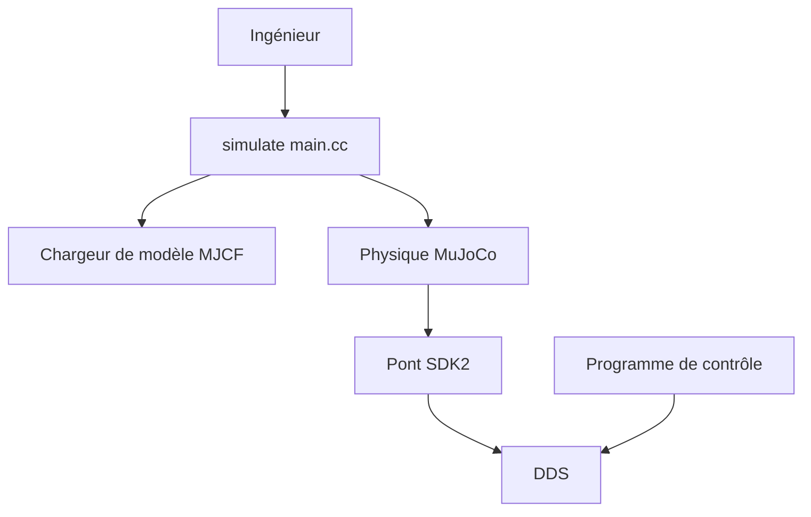

# unitreerobotics/unitree_mujoco

> MuJoCo simulator for Unitree robots to validate SDK2, ROS 2 or Python controllers before real hardware.

## The problem
Testing a controller directly on a quadruped or humanoid robot is expensive and risks breaking hardware.

## What it actually does
- Simulator in C++ (recommended) and in Python, communicating over DDS like the real robot.
- MJCF models for Go2, B2, H1, G1, AS2 and others, with terrain scenes.
- Simulated Xbox or Switch gamepad and a virtual elastic strap for humanoids.
- "Stand" examples in C++, Python and ROS 2: the same code in simulation and on the real robot by changing the interface.

## How it is wired


## Trying it
```bash
cd unitree_mujoco/simulate && mkdir build && cd build && cmake .. && make -j4
./unitree_mujoco -r go2 -s scene_terrain.xml
./test
python3 ./unitree_mujoco.py
```

## Cost and gotchas
Free. You need to install `unitree_sdk2`, MuJoCo and some Linux packages (the C++ build is required). DDS domains must be kept separate from those of the real robot.

## What it is not
Not a reinforcement learning tool: it provides the simulation bench, not the policies. Unitree-specific.

## Alternatives
No alternative named in the README.

## For you
Worth watching: a useful base if you train Unitree locomotion policies and want a simulation-to-real transfer without rewriting.
