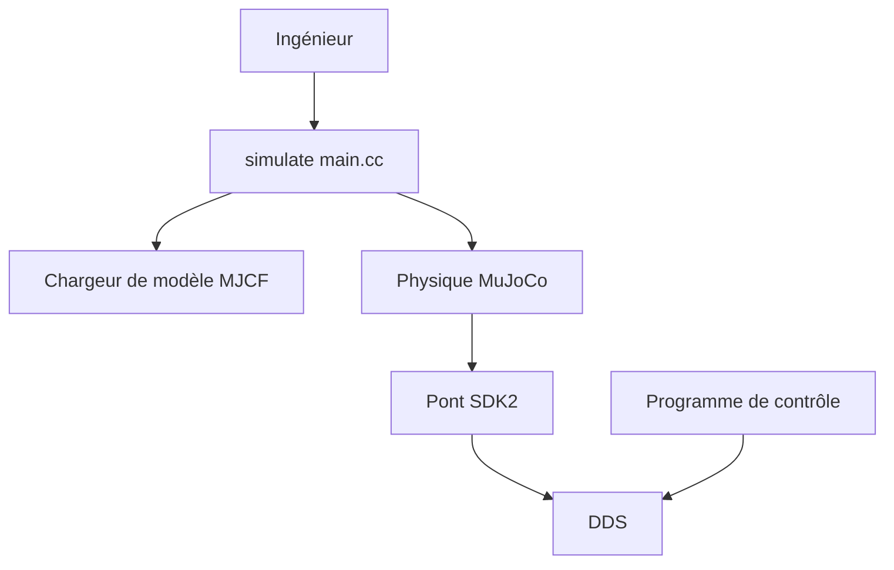

# unitreerobotics/unitree_mujoco

> Simulateur MuJoCo des robots Unitree pour valider des contrôleurs SDK2, ROS 2 ou Python avant le matériel réel.

## Le problème
Tester un contrôleur directement sur un robot quadrupède ou humanoïde coûte cher et risque de casser du matériel.

## Ce que ça fait vraiment
- Simulateur en C++ (recommandé) et en Python, communiquant en DDS comme le vrai robot.
- Modèles MJCF pour Go2, B2, H1, G1, AS2 et autres, avec scènes de terrain.
- Manette Xbox ou Switch simulée et sangle élastique virtuelle pour les humanoïdes.
- Exemples « stand » en C++, Python et ROS 2 : même code en simulation et en réel en changeant l'interface.

## Comment c'est branché


## Essayer
```bash
cd unitree_mujoco/simulate && mkdir build && cd build && cmake .. && make -j4
./unitree_mujoco -r go2 -s scene_terrain.xml
./test
python3 ./unitree_mujoco.py
```

## Coût et pièges
Gratuit. Il faut installer `unitree_sdk2`, MuJoCo et des paquets Linux (la compilation en C++ est requise). Les domaines DDS doivent être séparés de ceux du robot réel.

## Ce que ce n'est pas
Pas un outil d'apprentissage par renforcement : il fournit le banc de simulation, pas les politiques. Spécifique à Unitree.

## Alternatives
Aucune alternative nommée dans le README.

## Pour toi
À surveiller : base utile si tu entraînes des politiques de locomotion Unitree et veux un passage simulation vers réel sans réécriture.

