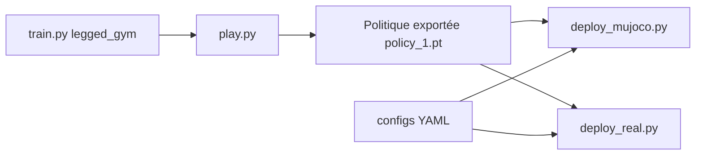

# unitreerobotics/unitree_rl_gym

> Reinforcement learning code to make Unitree robots walk (Go2, H1, H1_2, G1), from simulation to the real world.

## The problem
Learning a locomotion policy in simulation and then running it on a physical robot requires a coherent chain of scripts.

## What it actually does
The flow is Train, Replay, Sim2Sim, Sim2Real. `train.py` and `play.py` (legged_gym base, Isaac Gym, rsl_rl) train and export the actor network; `deploy_mujoco.py` tests the policy in MuJoCo with one YAML per robot; `deploy_real.py` deploys it through `unitree_sdk2_python`. A C++ example for the G1 relies on LibTorch.

## How it is wired


## Trying it
```bash
python legged_gym/scripts/train.py --task=xxx
python legged_gym/scripts/play.py --task=xxx
python deploy/deploy_mujoco/deploy_mujoco.py g1.yaml
python deploy/deploy_real/deploy_real.py {net_interface} {config_name}
```

## Cost and gotchas
Installation is described in an external `setup.md`. A GPU is required for Isaac Gym, and the robot must be in debug mode for real deployment. Last push in July 2025.

## What it is not
Not a generic RL framework: it is tailored to Unitree robots. The provided pretrained policy is a demonstration, not a guarantee on your hardware.

## Alternatives
The README cites its foundations: legged_gym, rsl_rl and mujoco.

## For you
Ignore unless you have a Unitree robot: specific hardware, a simulator outside the usual MLOps stack, and a project with little activity.
