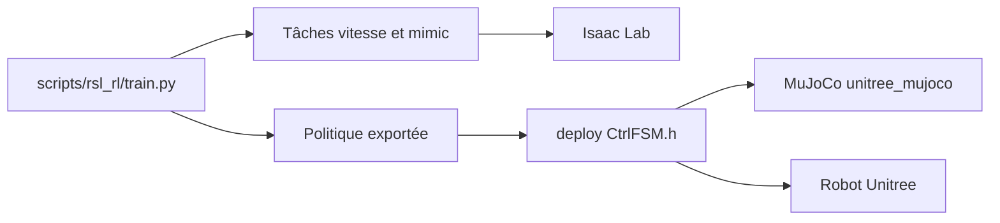

# unitreerobotics/unitree_rl_lab

> Reinforcement learning environments under Isaac Lab for Unitree Go2, H1 and G1 robots, all the way to deployment.

## The problem
Training a walking policy in simulation and then running it on a real robot requires an end-to-end path.

## What it actually does
Training tasks for velocity and motion imitation (PPO via rsl_rl) for Go2, H1 and G1-29dof under Isaac Lab, then C++ controllers that run the exported policy in MuJoCo (sim2sim) or on the robot (sim2real) through a state machine, using ONNX Runtime.

## How it is wired


## Trying it
```bash
./unitree_rl_lab.sh -i
./unitree_rl_lab.sh -l
./unitree_rl_lab.sh -t --task Unitree-G1-29dof-Velocity
./unitree_rl_lab.sh -p --task Unitree-G1-29dof-Velocity
```

## Cost and gotchas
Free, but Isaac Lab (NVIDIA GPU) must be installed first, along with the robot description files (USD or URDF) and `unitree_sdk2` for deployment. The sim2real command drives a real robot: the old onboard program must be shut down.

## What it is not
Not a generic RL framework: it is tied to Unitree robots and Isaac Lab. The README does not document reward design.

## Alternatives
IsaacLab (which it depends on), unitree_mujoco for sim2sim.

## For you
Ignore unless you own a Unitree robot: very tied to specific hardware and to Isaac Lab.
