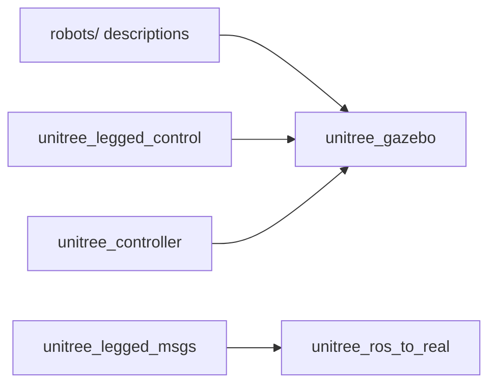

# unitreerobotics/unitree_ros

> ROS packages to simulate Unitree robots in Gazebo and drive their joints.

## The problem
Testing low-level control of a legged or humanoid robot on real hardware is risky and slow.

## What it actually does
Provides the descriptions (URDF, Xacro, meshes) of dozens of Unitree robots: quadrupeds, humanoids, arms, hands. A `UnitreeJointController` plugin drives position, velocity and torque in Gazebo. Example nodes (`unitree_servo`, `unitree_external_force`, `unitree_move_kinetic`) make the robot stand, push it or move it. Walking (high-level control) cannot be simulated.

## How it is wired

Simplified diagram based on the sheet, no diagram provided.

## Trying it
```bash
cd ~/catkin_ws
catkin_make
roslaunch unitree_gazebo normal.launch rname:=a1 wname:=stairs
rosrun unitree_controller unitree_servo
```

## Cost and gotchas
Old dependencies: ROS Melodic or Kinetic and Gazebo 8. A path must be edited by hand in `stairs.world` before compiling.

## What it is not
Neither a walking simulator nor a reinforcement learning platform. Reserved for Unitree robots.

## Alternatives
No alternative named in the README.

## For you
Ignore for a data / MLOps profile: it requires a Unitree robot and an old ROS stack, outside your scope.
