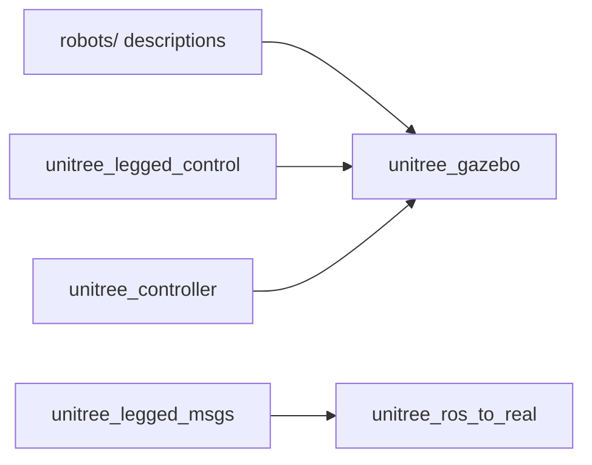

# unitreerobotics/unitree_ros

> Paquets ROS pour simuler dans Gazebo les robots Unitree et piloter leurs articulations.

## Le problème
Tester le contrôle bas niveau d'un robot à pattes ou humanoïde sur le vrai matériel est risqué et lent.

## Ce que ça fait vraiment
Fournit les descriptions (URDF, Xacro, meshes) de dizaines de robots Unitree : quadrupèdes, humanoïdes, bras, mains. Un plugin `UnitreeJointController` pilote position, vitesse et couple dans Gazebo. Des nœuds exemples (`unitree_servo`, `unitree_external_force`, `unitree_move_kinetic`) font tenir debout, bousculent ou déplacent le robot. La marche (contrôle haut niveau) n'est pas simulable.

## Comment c'est branché

Schéma simplifié d'après la fiche, sans diagramme fourni.

## Essayer
```bash
cd ~/catkin_ws
catkin_make
roslaunch unitree_gazebo normal.launch rname:=a1 wname:=stairs
rosrun unitree_controller unitree_servo
```

## Coût et pièges
Dépendances anciennes : ROS Melodic ou Kinetic et Gazebo 8. Un chemin à modifier à la main dans `stairs.world` avant la compilation.

## Ce que ce n'est pas
Ni un simulateur de marche, ni une plateforme d'apprentissage par renforcement. Réservé aux robots Unitree.

## Alternatives
Aucune alternative nommée dans le README.

## Pour toi
À ignorer pour un profil data / MLOps : il faut un robot Unitree et une pile ROS ancienne, hors de ton périmètre.

